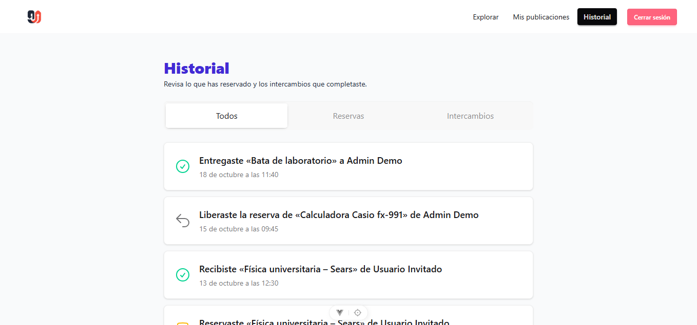
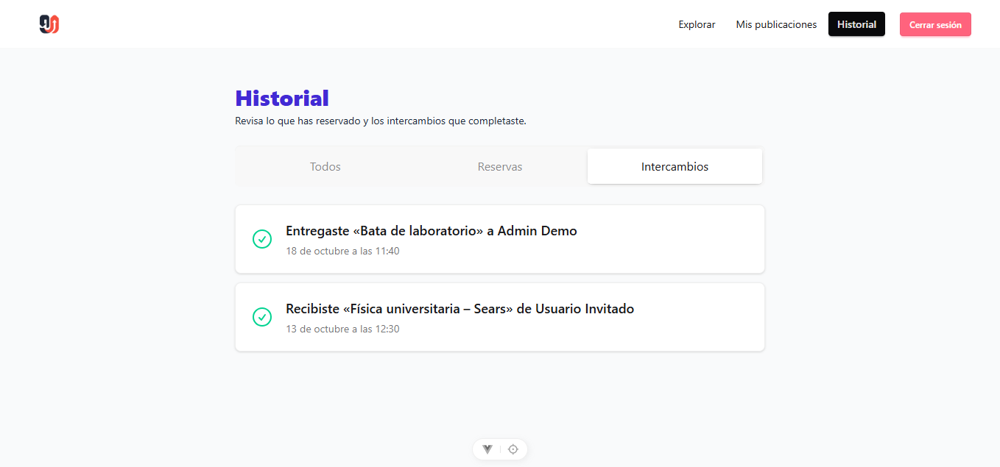
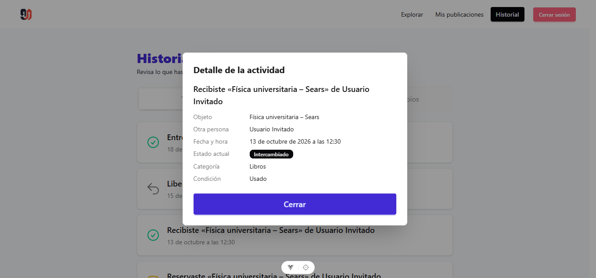
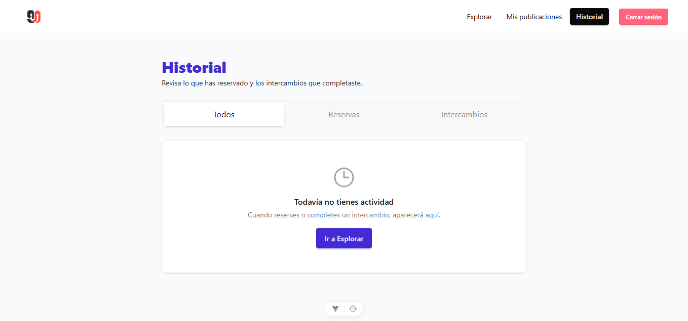

# Decisiones de interacción: historial de actividad (US-002)

**Principios aplicados:** ley de Fitts, ley de Hick y carga cognitiva.

**Cómo se probó:** backend con `npm run seed` (que ahora también crea eventos de historial), sesión iniciada como **Martita Becerra** (`martita@truequeu.com`, contraseña `Password123!`) y, para el estado vacío, como **Usuario Invitado** (`invitado@truequeu.com`), que no tiene actividad. Viewport de escritorio de 1358 px de ancho. Las medidas de tamaño y posición se obtuvieron con `getBoundingClientRect()` en el navegador.

**Nomenclatura de capturas** (`docs/evidencias/historial/`): `<principio>_historial.png`, más `vacio_historial.png` y `detalle_historial.png`.

---

## Decisión 1. Ley de Fitts: cada evento es un solo botón grande

**Captura:**

**Decisión:**

- Cada evento es **un botón completo** (`HistoryView.vue:125-126`). Se puede abrir el detalle pulsando en cualquier parte de la tarjeta, no solo en un enlace o ícono pequeño.
- El enlace "Historial" de la barra de navegación usa el mismo estilo que "Explorar" y "Mis publicaciones" (`Navbar.vue:38-42`).
- Los tres filtros son pestañas anchas (`HistoryView.vue:105-107`).
- El botón para cerrar el detalle es un botón grande de ancho completo, no una "×" (`HistoryView.vue:205`).

**Justificación (medidas):**

- **Tarjeta de evento:** **720 × 94 px**. Es muy superior al mínimo de 24 × 24 px de WCAG 2.5.8 y a los 44 px recomendados para pantallas táctiles. Las tarjetas están separadas por 12 px, así que es difícil pulsar la vecina por error.
- **Enlace de navegación:** "Historial" mide **77 × 33 px**, con la misma altura (33 px) que "Explorar" (74 × 33) y "Mis publicaciones" (134 × 33), y queda al lado de ellos.
- **Pestañas:** **237 × 48 px** cada una (Todos, Reservas, Intercambios).
- **Cerrar el detalle:** el botón "Cerrar" mide **462 × 48 px**, frente a los 16 × 16 px de la "×" que se corrigió en Explorar (hallazgo 1 de `hallazgos-interaccion.md`).
- **Estado vacío:** "Ir a Explorar" mide 111 × 40 px y está centrado debajo del mensaje.

**Estado:** Aplicado en el diseño inicial.

---

## Decisión 2. Ley de Hick: solo tres pestañas y ningún otro filtro

**Captura:**

**Decisión:**

- El historial tiene **un solo control de filtrado: tres pestañas** ("Todos", "Reservas", "Intercambios"). No hay búsqueda, selects ni filtros por fecha (`HistoryView.vue:105-111`).
- "Todos" es la pestaña por defecto, así que la persona ve su actividad completa sin elegir nada (`HistoryView.vue:34-37`).
- La pestaña activa se guarda en la dirección (`?type=reservas`, `?type=intercambios`), por lo que al recargar la página se mantiene (`HistoryView.vue:46-48` y `HistoryView.vue:98`).
- "Reservas" agrupa los eventos "reservado" y "reserva liberada", para no obligar a distinguirlos antes de entrar.

**Justificación:**

- **Cantidad:** el historial muestra **3 opciones** de filtrado. La pantalla Explorar, ya simplificada, muestra 3 controles con 4 opciones en la lista (hallazgo 2 de `hallazgos-interaccion.md`).
- **Comprobación:** al pulsar "Intercambios" la dirección cambia a `/history?type=intercambios` y la lista pasa de 5 eventos a **2** (los de tipo "intercambio completado").
- **Decisión rápida:** las tres opciones se leen de un vistazo, sin abrir menús, y cada una coincide con una pregunta frecuente: "qué hice", "qué reservé" y "qué intercambié".

**Estado:** Aplicado en el diseño inicial.

---

## Decisión 3. Carga cognitiva: la tarjeta se entiende sin recordar otras pantallas

**Captura:**

**Decisión:**

- Cada evento muestra primero **una frase completa** con el objeto y la otra persona, junto a un ícono que refuerza el tipo de evento (`HistoryView.vue:54-67` y `HistoryView.vue:145`):
  - "Reservaste «{objeto}» de {persona}"
  - "Liberaste la reserva de «{objeto}» de {persona}"
  - "Recibiste «{objeto}» de {persona}" (quien recibe)
  - "Entregaste «{objeto}» a {persona}" (el dueño)
- Debajo de la frase va la fecha en lenguaje natural, por ejemplo "18 de octubre a las 11:40" (`HistoryView.vue:146`).
- Los eventos más recientes están primero, de modo que lo último que hizo la persona es lo primero que ve.
- Los datos del objeto y de la otra persona se **guardan en el evento** al momento de la acción (título y nombre). Así la frase sigue siendo correcta aunque la publicación se edite o se elimine después.
- El estado vacío explica qué pasa y qué hacer: "Todavía no tienes actividad", "Cuando reserves o completes un intercambio, aparecerá aquí." y el botón "Ir a Explorar" (`HistoryView.vue:159-163`). Si una pestaña no tiene eventos, el mensaje habla solo de esa pestaña (`HistoryView.vue:39-44` y `HistoryView.vue:166`).
- El detalle usa el mismo modal que el resto de la aplicación y repite la frase, para que la persona no pierda el contexto (`HistoryView.vue:172-207`).

**Justificación:**

- **Recordar:** una etiqueta como "Reservado" obligaría a recordar qué objeto y con quién. La frase incluye ambos datos, por lo que no hace falta abrir Explorar ni "Mis publicaciones".
- **Interpretar:** cada tarjeta tiene solo **dos líneas** de texto (frase y fecha) y un ícono de 32 × 32 px. La información secundaria (categoría, condición y estado actual) queda en el detalle, no en la lista.
- **Comparar:** un evento propio como receptor ("Recibiste") y uno como dueño ("Entregaste") se diferencian por el verbo, sin necesidad de comparar nombres con el usuario actual.

**Detalle del evento:**

El detalle muestra el objeto, la otra persona, la fecha completa ("13 de octubre de 2026 a las 12:30"), el **estado actual** de la publicación con su insignia, la categoría y la condición. Si la publicación ya no existe, muestra "Esta publicación ya no está disponible."

**Estado vacío:**

**Estado:** Aplicado en el diseño inicial.

---

## Recorrido funcional

Cada criterio de aceptación del issue #19 y su evidencia:

| Criterio | Evidencia |
| --- | --- |
| CA-01. Se guarda un evento al reservar, liberar o completar | `post.controller.js:159`, `:170`, `:195` y `:203` crean los eventos; prueba 1 y prueba 5 de `activity.test.js` |
| CA-02. Solo se ven los eventos propios | `activity.controller.js` filtra por `userId` del token; prueba 2 de `activity.test.js` (otro usuario recibe lista vacía y 404 en el detalle) |
| CA-03. Al recargar se mantiene la información | Los eventos están en la base de datos y la pestaña activa en `?type=`; `carga_historial.png` es una recarga de `/history` |
| CA-04. Orden del más reciente al más antiguo | `order: [["createdAt", "DESC"]]` en `activity.controller.js`; prueba 4 de `activity.test.js` |
| CA-05. Mensaje claro y acceso a Explorar | `HistoryView.vue:159-163`; `vacio_historial.png` |
| CA-06. Detalle con objeto, persona, fecha y estado | `HistoryView.vue:172-207`; `detalle_historial.png`; prueba 3 de `activity.test.js` |
| CA-07. Pruebas automatizadas | `backend/tests/activity.test.js` (5 pruebas, todas pasan con `npm test`) |
