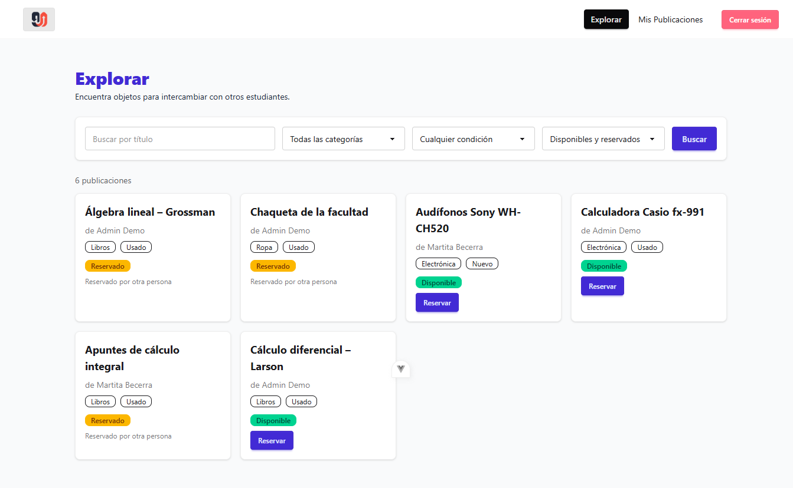

# Evaluación heurística: Trueque U

**Tarea evaluada:** encontrar un objeto y completar el intercambio.

**Recorrido:** Explorar (`/dashboard`) → filtrar o buscar → "Reservar" → "Completar intercambio". Del lado del dueño, el recorrido termina en Mis publicaciones (`/posts`), con el ícono de completar.

- **Caso permitido:** quien reservó completa el intercambio desde Explorar.
- **Caso bloqueado:** el dueño intenta completar una publicación que todavía no fue reservada.

## Hallazgos

| # | Pantalla y evidencia | Problema y consecuencia | Heurística | Severidad |
|---|---|---|---|---|
| 1 | **Explorar.** El objeto está reservado por mí y toco "Completar intercambio". Acepto el `confirm("¿Deseas marcar este intercambio como completado?")`. La grilla se reemplaza por un spinner y la tarjeta desaparece (`DashboardView.vue:115-121`). | Después de completar no aparece ningún mensaje de éxito. Además, la tarjeta deja de verse porque el filtro por defecto, "Disponibles y reservados", oculta las publicaciones intercambiadas. La persona no sabe si el intercambio se completó o si la publicación fue eliminada o falló, y puede intentar buscarla o repetir la acción. El backend sí devuelve "Intercambio completado.", pero la interfaz no lo muestra. | **H1. Visibilidad del estado del sistema.** La acción cambia el estado, pero la interfaz no informa el resultado. | **3. Mayor** |
| 2 | **Mis publicaciones** (caso bloqueado). En una publicación "disponible", el ícono de check (completar) aparece atenuado al 30 % de opacidad. El motivo solo figura en un tooltip al pasar el mouse: "Primero otro estudiante debe reservarlo" (`UserPostsView.vue:128-131`). | El bloqueo es correcto, pero el motivo no se ve: en móvil o táctil el tooltip no aparece. El dueño ve un botón apagado sin explicación y no sabe qué falta para completar el intercambio. | **H5. Prevención de errores.** La interfaz evita la acción, pero no explica el motivo junto al control. | **2. Menor** |
| 3 | **Explorar** comparado con **Mis publicaciones**. La misma acción aparece como el botón de texto "Completar intercambio" y "Liberar reserva" (`DashboardView.vue:214-217`). En la otra pantalla aparece como íconos sin texto: un check y un candado (`UserPostsView.vue:110-139`). El estado se muestra con el valor crudo en minúscula, por ejemplo "reservado" (`StateBadge.vue:15`), mientras que el filtro dice "Reservado" y el chip dice "Disponibilidad: …". | La persona debe volver a aprender la misma acción en cada pantalla. El candado suele significar "bloquear" y no "liberar reserva", así que se presta a confusión. Las etiquetas de estado cambian de forma entre pantallas: "Estado" y "Disponibilidad". | **H4. Consistencia y estándares.** La misma acción y el mismo estado no se presentan igual. | **2. Menor** |

## Hallazgo seleccionado

**Hallazgo 1 (H1, severidad 3).**

**Justificación:** ocurre cada vez que se completa un intercambio, que es el objetivo final de la tarea. Afecta el resultado y no solo la apariencia, porque la persona termina sin saber si lo logró. Ese desconocimiento lleva a repetir la acción o a buscar una publicación que ya no aparece en el listado.

## Mejora aplicada al hallazgo 1

| Observación | Heurística | Severidad | Mejora | Comprobación |
|---|---|---|---|---|
| Al completar el intercambio no aparece ninguna confirmación y la tarjeta desaparece del listado. | H1 | 3. Mayor | Después de completar, se muestra un mensaje de éxito con el nombre del objeto y la otra persona. El mensaje explica por qué el objeto ya no aparece en "Disponibles y reservados" y ofrece dos acciones: "Ver intercambiados" y "Cerrar". | Otra persona completa un intercambio y explica qué ocurrió sin recibir ayuda. |

### Evidencias

| Momento | Captura |
|---|---|
| Antes: objeto reservado, listo para completar |  |
| Antes: después de completar, la tarjeta desaparece sin ningún mensaje |  |
| Después: mensaje de éxito con el objeto, la otra persona y las acciones disponibles |  |
| Después: "Ver intercambiados" lleva al objeto completado |  |
