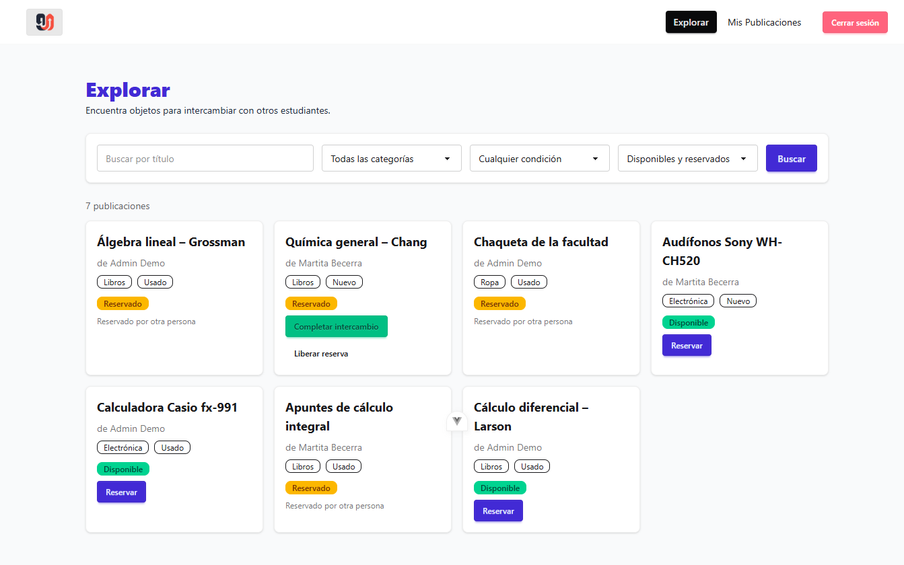
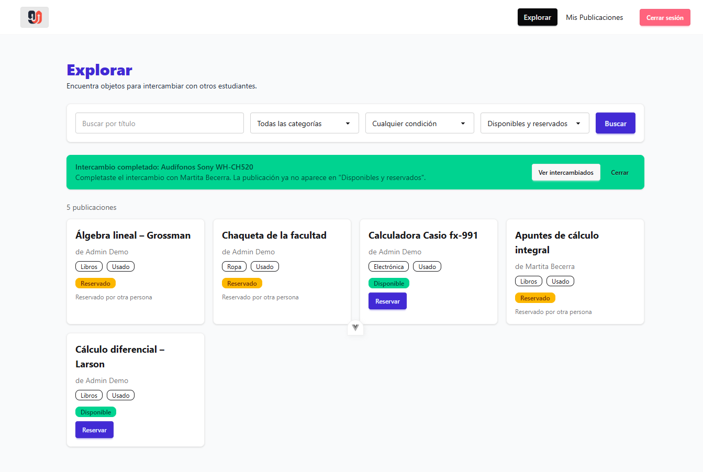
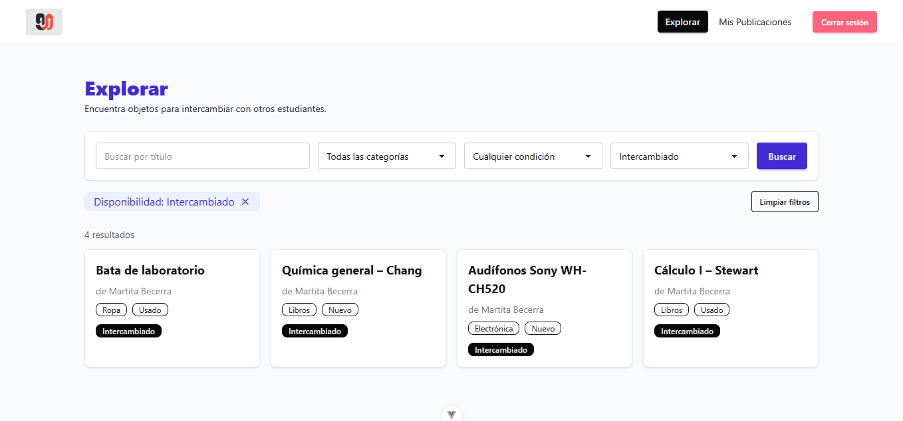
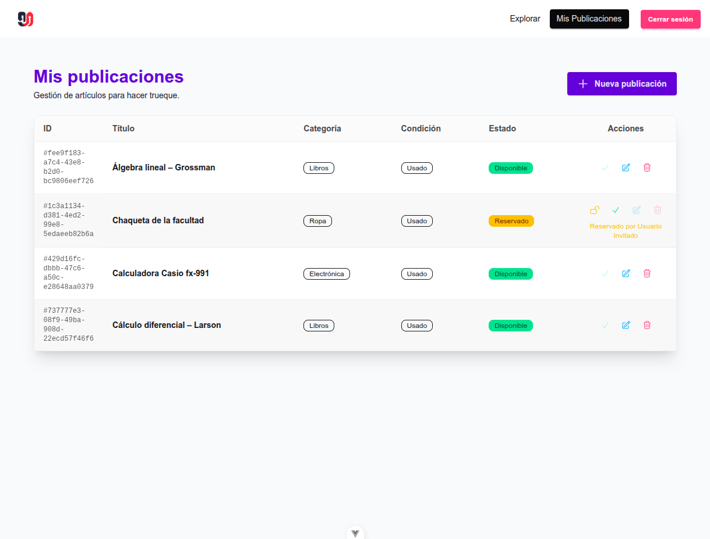
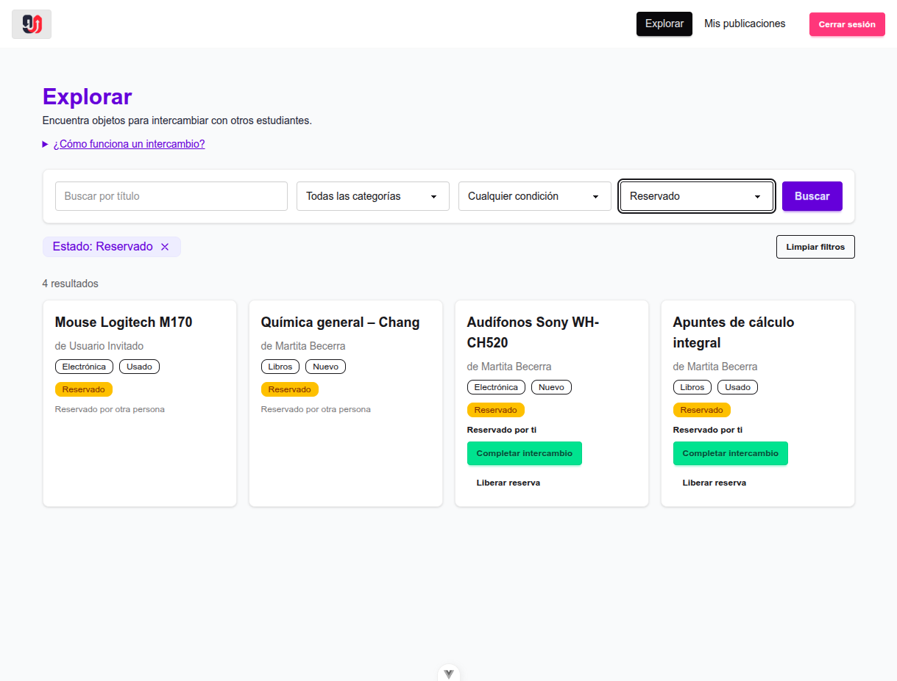
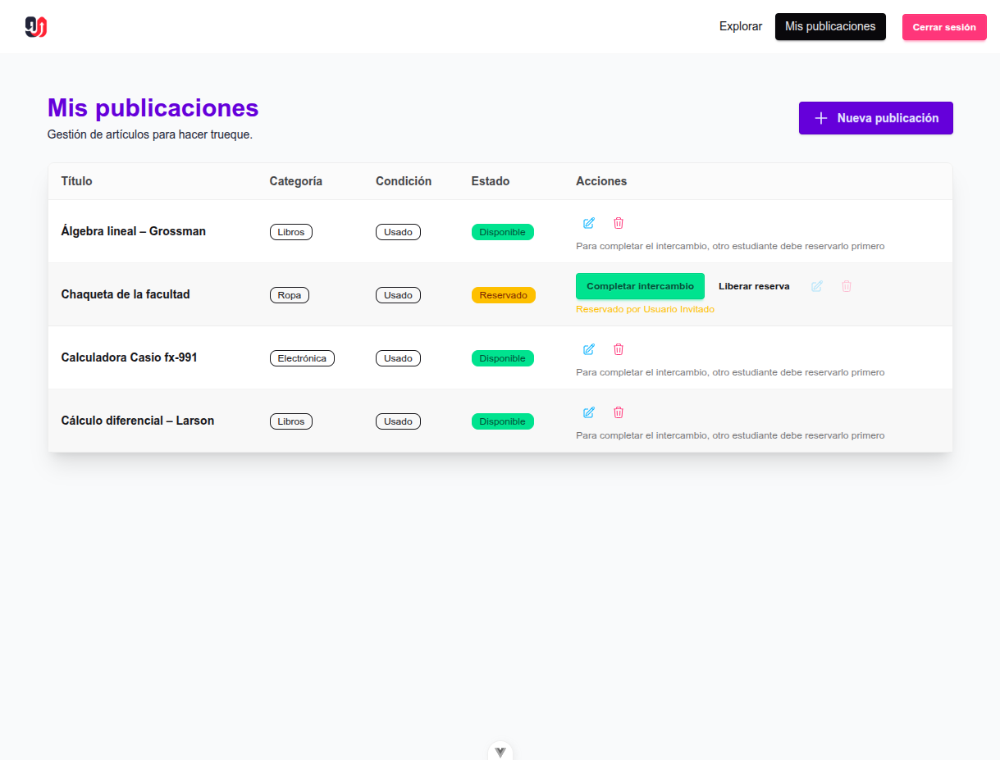
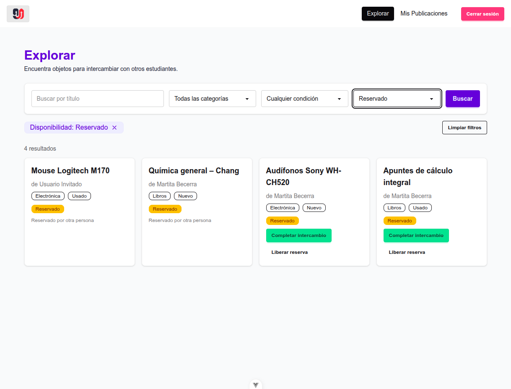
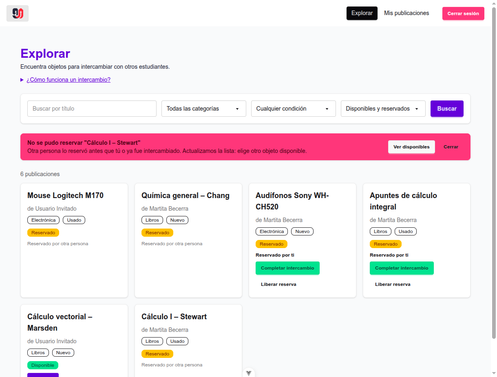
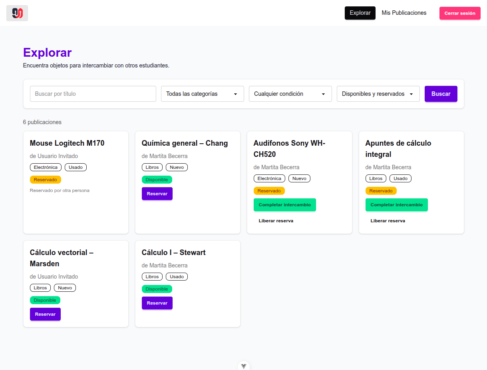
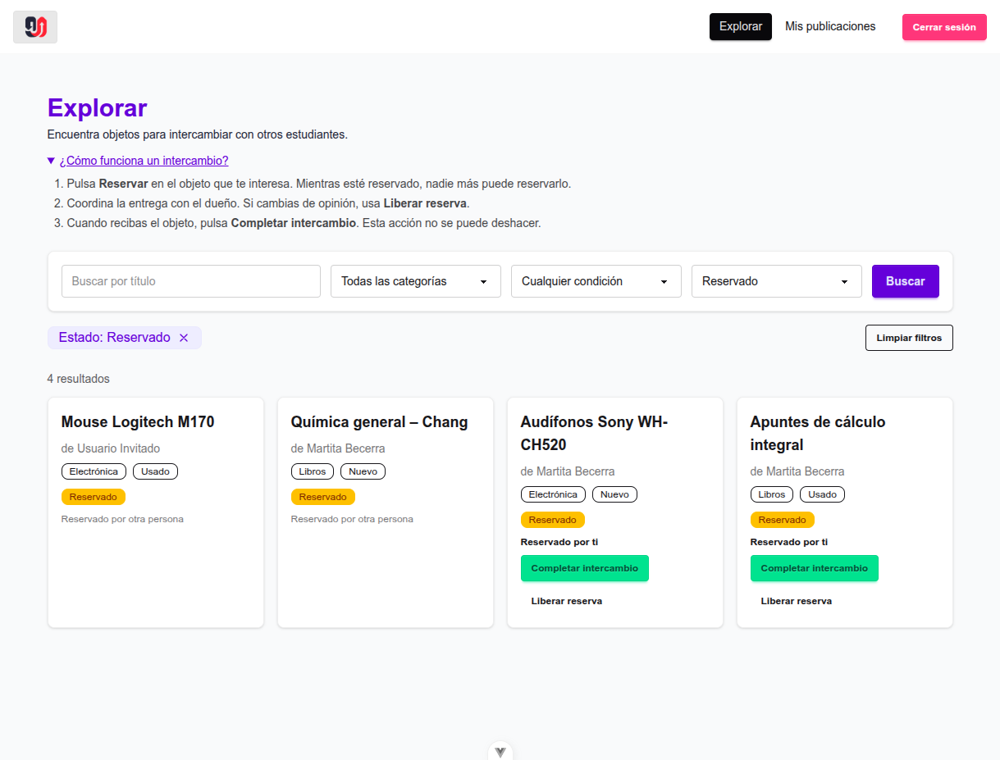

# Evaluación heurística: Trueque U

**Tarea evaluada:** encontrar un objeto y completar el intercambio.

**Recorrido:** Explorar (`/dashboard`) → filtrar o buscar → "Reservar" → "Completar intercambio". Del lado del dueño, el recorrido termina en Mis publicaciones (`/posts`), con la acción de completar.

- **Caso permitido:** quien reservó completa el intercambio desde Explorar.
- **Caso bloqueado:** el dueño intenta completar una publicación que todavía no fue reservada.

**Cómo se probó:** backend con `npm run seed` (usuarios `admin@truequeu.com`, `martita@truequeu.com` e `invitado@truequeu.com`, contraseña `Password123!`), sesión iniciada como **Admin Demo**. Admin tiene reservados dos objetos de Martita ("Audífonos Sony WH-CH520" y "Apuntes de cálculo integral"). Para el caso de error (H9) se reservó un objeto con otra cuenta mientras Admin todavía lo veía como disponible.

**Nomenclatura de capturas** (`docs/evidencias/`): `H<heurística>_<número>_<antes|despues|cumple>.png`. Por ejemplo, `H4_1_antes.png` es la primera captura de H4 antes de corregir.

---

## Parte 1. Trabajo en clase

### Hallazgos

| #   | Pantalla y evidencia                                                                                                                                                                                                                                                                                                                                                         | Problema y consecuencia                                                                                                                                                                                                                                                                                                                                                                                                   | Heurística                                                                                                        | Severidad    |
| --- | ---------------------------------------------------------------------------------------------------------------------------------------------------------------------------------------------------------------------------------------------------------------------------------------------------------------------------------------------------------------------------- | ------------------------------------------------------------------------------------------------------------------------------------------------------------------------------------------------------------------------------------------------------------------------------------------------------------------------------------------------------------------------------------------------------------------------- | ----------------------------------------------------------------------------------------------------------------- | ------------ |
| 1   | **Explorar.** El objeto está reservado por mí y toco "Completar intercambio". Acepto el `confirm("¿Deseas marcar este intercambio como completado?")`. La grilla se reemplaza por un spinner y la tarjeta desaparece (`DashboardView.vue:115-121`).                                                                                                                          | Después de completar no aparece ningún mensaje de éxito. Además, la tarjeta deja de verse porque el filtro por defecto, "Disponibles y reservados", oculta las publicaciones intercambiadas. La persona no sabe si el intercambio se completó o si la publicación fue eliminada o falló, y puede intentar buscarla o repetir la acción. El backend sí devuelve "Intercambio completado.", pero la interfaz no lo muestra. | **H1. Visibilidad del estado del sistema.** La acción cambia el estado, pero la interfaz no informa el resultado. | **3. Mayor** |
| 2   | **Mis publicaciones** (caso bloqueado). En una publicación "disponible", el ícono de check (completar) aparece atenuado al 30 % de opacidad. El motivo solo figura en un tooltip al pasar el mouse: "Primero otro estudiante debe reservarlo" (`UserPostsView.vue:128-131`).                                                                                                 | El bloqueo es correcto, pero el motivo no se ve: en móvil o táctil el tooltip no aparece. El dueño ve un botón apagado sin explicación y no sabe qué falta para completar el intercambio.                                                                                                                                                                                                                                 | **H5. Prevención de errores.** La interfaz evita la acción, pero no explica el motivo junto al control.           | **2. Menor** |
| 3   | **Explorar** comparado con **Mis publicaciones**. La misma acción aparece como el botón de texto "Completar intercambio" y "Liberar reserva" (`DashboardView.vue:214-217`). En la otra pantalla aparece como íconos sin texto: un check y un candado (`UserPostsView.vue:110-139`). El filtro dice "Reservado", el chip dice "Disponibilidad: …" y la columna dice "Estado". | La persona debe volver a aprender la misma acción en cada pantalla. El candado suele significar "bloquear" y no "liberar reserva", así que se presta a confusión. Las etiquetas de estado cambian de nombre entre pantallas: "Estado" y "Disponibilidad".                                                                                                                                                                 | **H4. Consistencia y estándares.** La misma acción y el mismo estado no se presentan igual.                       | **2. Menor** |

### Hallazgo seleccionado

**Hallazgo 1 (H1, severidad 3).**

**Justificación:** ocurre cada vez que se completa un intercambio, que es el objetivo final de la tarea. Afecta el resultado y no solo la apariencia, porque la persona termina sin saber si lo logró. Ese desconocimiento lleva a repetir la acción o a buscar una publicación que ya no aparece en el listado.

### Mejora aplicada al hallazgo 1

| Observación                                                                                      | Heurística | Severidad | Mejora                                                                                                                                                                                                                                    | Comprobación                                                                  |
| ------------------------------------------------------------------------------------------------ | ---------- | --------- | ----------------------------------------------------------------------------------------------------------------------------------------------------------------------------------------------------------------------------------------- | ----------------------------------------------------------------------------- |
| Al completar el intercambio no aparece ninguna confirmación y la tarjeta desaparece del listado. | H1         | 3. Mayor  | Después de completar, se muestra un mensaje de éxito con el nombre del objeto y la otra persona. El mensaje explica por qué el objeto ya no aparece en "Disponibles y reservados" y ofrece dos acciones: "Ver intercambiados" y "Cerrar". | Otra persona completa un intercambio y explica qué ocurrió sin recibir ayuda. |

| Momento                                                                             | Captura                          |
| ----------------------------------------------------------------------------------- | -------------------------------- |
| Antes: objeto reservado, listo para completar                                       |    |
| Antes: después de completar, la tarjeta desaparece sin ningún mensaje               |    |
| Después: mensaje de éxito con el objeto, la otra persona y las acciones disponibles |  |
| Después: "Ver intercambiados" lleva al objeto completado                            |  |

Los hallazgos 2 y 3 de clase se retoman en la Parte 2 como H5 y H4.

---

## Parte 2. Tarea 3: evaluación H1–H10

### Resumen

Issue principal: #11.

| # | Pantalla y evidencia | Problema y consecuencia | Heurística | Severidad | Estado |
| --- | --- | --- | --- | --- | --- |
| 1 | **Explorar.** Toco "Completar intercambio" en un objeto reservado por mí y acepto la confirmación (`H1_1_despues.png`, `DashboardView.vue`, mensaje con `role="status"`). | Sin problema desde la mejora de clase. Aparece "Intercambio completado: *objeto*" con la otra persona, el motivo por el que deja de verse en el listado y las acciones "Ver intercambiados" y "Cerrar". | **H1. Visibilidad del estado del sistema.** La interfaz informa el resultado de la acción. | **0. No es un problema** | Cumple (corregido en clase) |
| 2 | **Mis publicaciones.** La primera columna, "ID", muestra el UUID de la base de datos, por ejemplo `#fee9f183-a7c4-…` (`H2_1_antes.png`, `UserPostsView.vue:86,94`). Los mensajes de sesión dicen "falta el token de sesion" y "Token invalido o expirado" (`auth.js:8,14`). | El ID no significa nada para el estudiante, ocupa cuatro líneas por fila y empuja el título, que es lo que usa para reconocer su objeto. Si la sesión expira, lee la palabra "token", que no es parte de su vocabulario. | **H2. Relación con el mundo real.** Muestra datos internos y jerga técnica en lugar de conceptos del usuario. | **1. Cosmético** | No cumple, sub-issue #12 |
| 3 | **Explorar.** Tarjeta reservada por mí (`H3_1_cumple.png`). | Sin problema. "Liberar reserva" deshace la reserva. "Completar intercambio", que es irreversible, pide confirmación y se puede cancelar. Los filtros se quitan con la "x" del chip o con "Limpiar filtros". | **H3. Control y libertad.** Hay salida para las acciones iniciadas por error. | **0. No es un problema** | Cumple |
| 4 | **Explorar** comparado con **Mis publicaciones.** En Explorar las acciones son botones con texto; en Mis publicaciones son íconos de check y candado (`H4_1_antes.png`, `UserPostsView.vue:110-139`). El chip dice "Disponibilidad", la columna dice "Estado" y el menú dice "Mis Publicaciones" (`H4_2_antes.png`). | La persona debe aprender dos veces la misma acción, y el candado sugiere "bloquear", no "liberar reserva". El mismo dato cambia de nombre entre pantallas. | **H4. Consistencia y estándares.** La misma acción y el mismo estado no se presentan igual. | **2. Menor** | No cumple, sub-issue #13 |
| 5 | **Mis publicaciones** (caso bloqueado). En una publicación "Disponible", el check de completar aparece al 30 % y el motivo solo está en un tooltip (`H5_1_antes.png`, `UserPostsView.vue:128-138`). La confirmación dice solo "¿Deseas marcar este intercambio como completado?" (`DashboardView.vue:122`, `UserPostsView.vue:56`). | En pantallas táctiles el tooltip no aparece y el dueño no sabe qué falta. Completar es irreversible, pero la confirmación no dice qué objeto ni con quién, así que es fácil confirmar el equivocado. | **H5. Prevención de errores.** No explica el bloqueo junto al control ni da datos para confirmar una acción irreversible. | **2. Menor** | No cumple, sub-issue #14 |
| 6 | **Explorar** con el filtro "Reservado" (`H6_1_antes.png`, `DashboardView.vue:234-243`). Las reservas ajenas dicen "Reservado por otra persona"; las mías no dicen nada. | Para encontrar su reserva, la persona debe recordar qué reservó o deducirlo porque esa tarjeta tiene botones. | **H6. Reconocer antes que recordar.** El dato necesario para decidir no está visible en la tarjeta. | **2. Menor** | No cumple, sub-issue #15 |
| 7 | **Explorar.** Buscar y filtrar (`H7_1_cumple.png`, `DashboardView.vue:76-82,181-193`). | Sin problema. Los `select` filtran apenas cambian, el texto se busca con Enter y los filtros se guardan en la URL, así que se conservan al recargar o volver. | **H7. Flexibilidad y eficiencia.** Sirve a quien empieza y a quien ya conoce la app. | **0. No es un problema** | Cumple |
| 8 | **Explorar.** Tarjetas del listado (`H8_1_cumple.png`, `DashboardView.vue:256-287`). | Sin problema. Cada tarjeta muestra solo los datos para decidir y una acción principal ("Reservar" o "Completar intercambio"). "Liberar reserva" es secundaria (`btn-ghost`). | **H8. Diseño estético y minimalista.** La acción principal no compite con elementos irrelevantes. | **0. No es un problema** | Cumple |
| 9 | **Explorar**, caso de conflicto. Otra cuenta reserva "Química general – Chang" mientras yo la veo disponible, y pulso "Reservar" (`H9_1_antes.png`, `DashboardView.vue:105-112`). | Aparece un `alert()` con "Solo el dueño o quien reservó pueden liberar la reserva.", que es el mensaje de otra acción y no ofrece salida. La tarjeta sigue diciendo "Disponible" porque la lista no se recarga tras el error, así que la persona puede repetir el intento sin entender qué pasa. | **H9. Reconocer y recuperarse de errores.** El mensaje no explica el problema real ni cómo continuar. | **3. Mayor** | No cumple, sub-issue #16 |
| 10 | **Explorar**, primera visita (`H10_1_antes.png`, `DashboardView.vue:147`). Solo hay título y subtítulo. | No se explica el orden del intercambio: reservar, coordinar o liberar, y completar. Una persona nueva puede creer que "Reservar" ya completa el intercambio. | **H10. Ayuda y documentación.** Falta una ayuda breve donde se decide la acción. | **1. Cosmético** | No cumple, sub-issue #17 |

---

### H1. Visibilidad del estado del sistema — Cumple

- **Pantalla o flujo:** Explorar → "Completar intercambio" → aceptar la confirmación.
- **Explicación:** después de la mejora de clase, al completar aparece un mensaje con `role="status"`: "Intercambio completado: *objeto*. Completaste el intercambio con *persona*…", con las acciones "Ver intercambiados" y "Cerrar". Al reservar o liberar, la tarjeta cambia en el momento su badge ("Disponible" ↔ "Reservado") y sus botones. En Mis publicaciones, la fila muestra "Reservado por *nombre*" o "Intercambiado, no se puede modificar".
- **Cómo se comprobó:** se completó "Audífonos Sony WH-CH520" como Admin y se leyó el mensaje sin otra ayuda. Luego "Ver intercambiados" mostró el objeto con el estado "Intercambiado".
- **Captura:** `H1_1_despues.png`, `H1_2_despues.png` (ver Parte 1).
- **Código:** `frontend/src/views/DashboardView.vue:217-229` (mensaje de éxito) y `DashboardView.vue:135-148` (`handleComplete`).

### H2. Relación con el mundo real — No cumple (severidad 1, cosmético) · #12

- **Pantalla o flujo:** Mis publicaciones (`/posts`).
- **Problema:** la primera columna, "ID", muestra el identificador interno de la base de datos, un UUID como `#fee9f183-a7c4-43e8-b2d0-bc9806eef726`. Para un estudiante ese dato no significa nada. Además, ocupa cuatro líneas por fila y empuja el título, que es el dato con el que la persona reconoce su objeto. En el backend, los mensajes de sesión usan jerga técnica y les faltan tildes: "Acceso no autorizado: falta el token de sesion" y "Token invalido o expirado".
- **Consecuencia:** la tabla es más difícil de recorrer. Si la sesión expira, la persona lee la palabra "token", que no forma parte de su vocabulario.
- **Código (antes):** `UserPostsView.vue:86` y `:94` (columna ID); `backend/src/middleware/auth.js:8` y `:14`.
- **Corrección:** se eliminó la columna ID de la tabla y los mensajes pasaron a "Debes iniciar sesión para continuar." y "Tu sesión expiró. Inicia sesión nuevamente.".
- **Comprobación:** la tabla abre con el título como primera columna y cada fila ocupa una sola línea.
- **Archivos modificados:** `frontend/src/views/UserPostsView.vue`, `backend/src/middleware/auth.js`.

| Antes                          | Después                          |
| ------------------------------ | -------------------------------- |
|  |  |

### H3. Control y libertad — Cumple

- **Pantalla o flujo:** Explorar, en una tarjeta reservada por mí.
- **Explicación:** la reserva se puede deshacer con "Liberar reserva", disponible en Explorar y en Mis publicaciones. "Completar intercambio", que es irreversible, pide confirmación antes de ejecutarse y se puede cancelar. Los filtros se quitan uno por uno con la "x" del chip o todos juntos con "Limpiar filtros". El formulario de publicación tiene "Cancelar".
- **Cómo se comprobó:** en las tarjetas reservadas por Admin, "Liberar reserva" está junto a "Completar intercambio". En el código, liberar devuelve la publicación a "disponible" (`post.controller.js:150-153`) y `handleComplete` termina sin cambiar nada si se cancela el `confirm`.
- **Captura:** `H3_1_cumple.png` (botón "Liberar reserva" junto a "Completar intercambio").
- **Código:** `DashboardView.vue:275-283`, `UserPostsView.vue:123-129` y `PostForm.vue:93-95`.

### H4. Consistencia y estándares — No cumple (severidad 2, menor) · #13

- **Pantalla o flujo:** Explorar comparado con Mis publicaciones.
- **Problema:** en Explorar, las acciones son botones con texto ("Completar intercambio" y "Liberar reserva"). En Mis publicaciones, las mismas acciones son íconos sin texto: un check y un candado abierto. El candado no comunica "liberar reserva". El mismo dato se llama "Estado" en la columna de la tabla y "Disponibilidad" en el chip del filtro. El menú dice "Mis Publicaciones" y el título de la página, "Mis publicaciones".
- **Consecuencia:** la persona debe aprender dos veces la misma acción y puede confundir el candado con "bloquear".
- **Código (antes):** `UserPostsView.vue:110-139` (íconos), `DashboardView.vue:62` (chip "Disponibilidad") y `Navbar.vue:35`.
- **Corrección:** Mis publicaciones usa los mismos botones con texto que Explorar, con las mismas clases (`btn-success` y `btn-ghost`). El chip ahora dice "Estado: …" y el menú, "Mis publicaciones".
- **Comprobación:** se completó y se liberó una reserva desde ambas pantallas usando los mismos botones.
- **Nota:** el badge de estado se ve igual en ambas pantallas porque `StateBadge.vue` aplica `capitalize`, así que ese punto no requiere cambios.
- **Archivos modificados:** `frontend/src/views/UserPostsView.vue`, `frontend/src/views/DashboardView.vue`, `frontend/src/components/Navbar.vue`.

| Antes                          | Después                          |
| ------------------------------ | -------------------------------- |
|  |  |
|  |  |

### H5. Prevención de errores — No cumple (severidad 2, menor) · #14

- **Pantalla o flujo:** Mis publicaciones, caso bloqueado (publicación "Disponible"), y la confirmación al completar en ambas pantallas.
- **Problema:** el check de completar aparece apagado al 30 % y el motivo solo está en un tooltip, que no aparece en pantallas táctiles. Por otro lado, completar es irreversible, pero la confirmación es genérica: "¿Deseas marcar este intercambio como completado?". No dice qué objeto, con quién, ni que no se puede deshacer.
- **Consecuencia:** el dueño no sabe qué le falta para completar. En el caso permitido, una persona con varias reservas puede confirmar el objeto equivocado sin notarlo.
- **Código (antes):** `UserPostsView.vue:128-138` (tooltip), `UserPostsView.vue:56` y `DashboardView.vue:122` (`confirm` genérico).
- **Corrección:** en las publicaciones disponibles se muestra un texto visible bajo las acciones: "Para completar el intercambio, otro estudiante debe reservarlo primero". La confirmación ahora nombra el objeto y a la otra persona, y advierte que la acción no se puede deshacer:
  - Explorar: `¿Confirmas que recibiste "Audífonos Sony WH-CH520" de Martita Becerra? El intercambio quedará cerrado y no se puede deshacer.`
  - Mis publicaciones: `¿Confirmas que entregaste "Chaqueta de la facultad" a Usuario Invitado? El intercambio quedará cerrado y no se puede deshacer.`
- **Comprobación:** el motivo del bloqueo se lee sin pasar el mouse. La confirmación es un cuadro nativo del navegador y no sale en la captura; el texto está en `DashboardView.vue:136-139` y `UserPostsView.vue:63-66`.
- **Archivos modificados:** `frontend/src/views/UserPostsView.vue`, `frontend/src/views/DashboardView.vue`.

| Antes                          | Después                          |
| ------------------------------ | -------------------------------- |
|  |  |

### H6. Reconocer antes que recordar — No cumple (severidad 2, menor) · #15

- **Pantalla o flujo:** Explorar con el filtro "Reservado", para encontrar el objeto que reservé y completarlo.
- **Problema:** las tarjetas reservadas por otras personas dicen "Reservado por otra persona", pero las que reservé yo no dicen nada. Solo se distinguen porque tienen botones. No hay ningún texto que diga que la reserva es mía.
- **Consecuencia:** para encontrar su objeto entre varios reservados, la persona tiene que recordar qué reservó o deducirlo por los botones.
- **Código (antes):** `DashboardView.vue:234-243`.
- **Corrección:** las tarjetas reservadas por la persona muestran "Reservado por ti" encima de las acciones, en el mismo lugar donde las demás muestran "Reservado por otra persona".
- **Comprobación:** con el filtro "Reservado", se identifican las reservas propias leyendo la tarjeta.
- **Archivos modificados:** `frontend/src/views/DashboardView.vue`.

| Antes                          | Después                          |
| ------------------------------ | -------------------------------- |
|  |  |

### H7. Flexibilidad y eficiencia — Cumple

- **Pantalla o flujo:** Explorar, al buscar y filtrar.
- **Explicación:** cada `select` aplica el filtro apenas cambia (`@change="search"`), sin pulsar "Buscar". El texto se busca con Enter. Los filtros se guardan en la URL (`/dashboard?state=reservado`), así que se conservan al recargar, al volver desde otra pantalla o al compartir el enlace. Los chips permiten quitar un filtro con un clic.
- **Cómo se comprobó:** al elegir "Reservado", la lista se filtró sin pulsar "Buscar", apareció el chip y la URL cambió a `/dashboard?state=reservado`. Como la vista lee los filtros desde la URL (`watch` sobre `route.query` con `immediate: true`), se restauran al recargar o al volver con "Atrás".
- **Captura:** `H7_1_cumple.png`.
- **Código:** `DashboardView.vue:76-82` (`applyFilters` con `router.push` y la query) y `DashboardView.vue:181-193` (`@change="search"`).

### H8. Diseño estético y minimalista — Cumple

- **Pantalla o flujo:** tarjetas de Explorar.
- **Explicación:** cada tarjeta muestra solo lo necesario para decidir: título, dueño, categoría, condición, estado y una sola acción principal. En una tarjeta disponible, la acción es "Reservar" (`btn-primary`). En una reservada por mí, la principal es "Completar intercambio" (`btn-success`) y la secundaria, "Liberar reserva", es un `btn-ghost` que no compite visualmente. En las reservadas por otros no hay botones, solo un texto.
- **Cómo se comprobó:** en la captura, la acción principal de cada tarjeta se identifica a simple vista.
- **Captura:** `H8_1_cumple.png`.
- **Código:** `DashboardView.vue:256-287`.

### H9. Reconocer y recuperarse de errores — No cumple (severidad 3, mayor) · #16

- **Pantalla o flujo:** Explorar, caso de conflicto. Admin ve "Química general – Chang" como disponible, pero mientras tanto otra cuenta la reserva. Admin pulsa "Reservar".
- **Problema:** aparece un `alert()` nativo con el texto **"Solo el dueño o quien reservó pueden liberar la reserva."**. Ese mensaje corresponde a otra acción, porque la persona quería reservar y no liberar. Tampoco ofrece una salida. Además, como la lista solo se recarga cuando la acción sale bien, después de cerrar el alert la tarjeta sigue mostrando "Disponible" y el botón "Reservar", aunque ya no lo está. Lo mismo ocurre con todos los errores de Explorar y Mis publicaciones, que se muestran con `alert(err.message)`.
- **Consecuencia:** la persona no entiende qué pasó, puede volver a intentarlo con el mismo resultado y no sabe cómo continuar. Afecta el paso central de la tarea, que es conseguir la reserva.
- **Código (antes):** `DashboardView.vue:105-112` (`alert` sin recarga), `UserPostsView.vue:43,51,60` y `backend/src/rules/postRules.js:27`.
- **Corrección:** los errores se muestran en un aviso dentro de la página (`role="alert"`) y siempre se recarga la lista. Si falla una reserva, el aviso dice **"No se pudo reservar *objeto*. Otra persona lo reservó antes que tú o ya fue intercambiado. Actualizamos la lista: elige otro objeto disponible."** y ofrece "Ver disponibles" y "Cerrar". En Mis publicaciones se muestra el mensaje del backend y se agrega "La lista se actualizó con el estado actual.".
- **Comprobación:** se repitió el conflicto con "Cálculo I – Stewart". El aviso explica el motivo y ofrece "Ver disponibles" (aplica el filtro `state=disponible`). La tarjeta pasa a "Reservado por otra persona" sin recargar la página a mano.
- **Archivos modificados:** `frontend/src/views/DashboardView.vue`, `frontend/src/views/UserPostsView.vue`.

| Antes                          | Después                          |
| ------------------------------ | -------------------------------- |
|  |  |

En la captura de "antes" no aparece el `alert` nativo porque el navegador lo dibuja fuera de la página. Su texto exacto es el que se cita arriba.

### H10. Ayuda y documentación — No cumple (severidad 1, cosmético) · #17

- **Pantalla o flujo:** Explorar, primera visita.
- **Problema:** en ningún lugar se explica cómo funciona un intercambio: que primero se reserva, que mientras tanto nadie más puede reservar, que la reserva se puede liberar y que completar es el último paso y no se deshace.
- **Consecuencia:** una persona nueva puede pensar que "Reservar" ya completa el intercambio, o no saber cuándo pulsar "Completar intercambio".
- **Código (antes):** `DashboardView.vue:147` (solo título y subtítulo).
- **Corrección:** se agregó un enlace desplegable, "¿Cómo funciona un intercambio?", debajo del título, con tres pasos breves. Queda cerrado por defecto para no agregar ruido (H8).
- **Comprobación:** una persona nueva abre la ayuda y explica el orden de los pasos sin preguntar.
- **Archivos modificados:** `frontend/src/views/DashboardView.vue`.

| Antes                           | Después                           |
| ------------------------------- | --------------------------------- |
|  |  |
