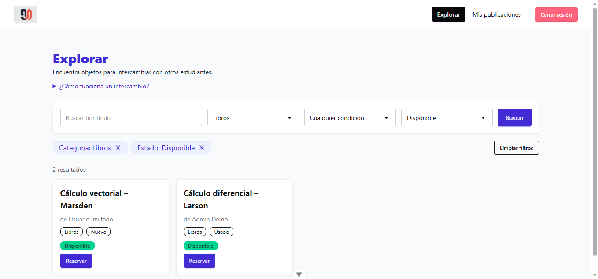
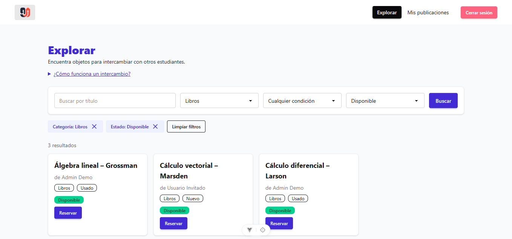
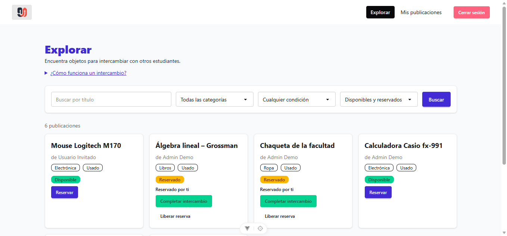
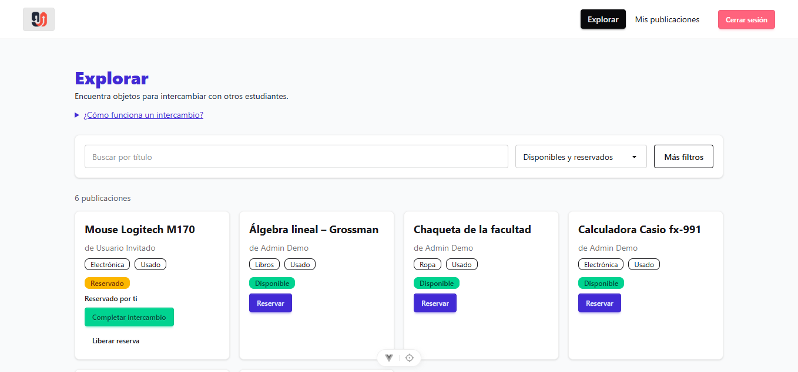
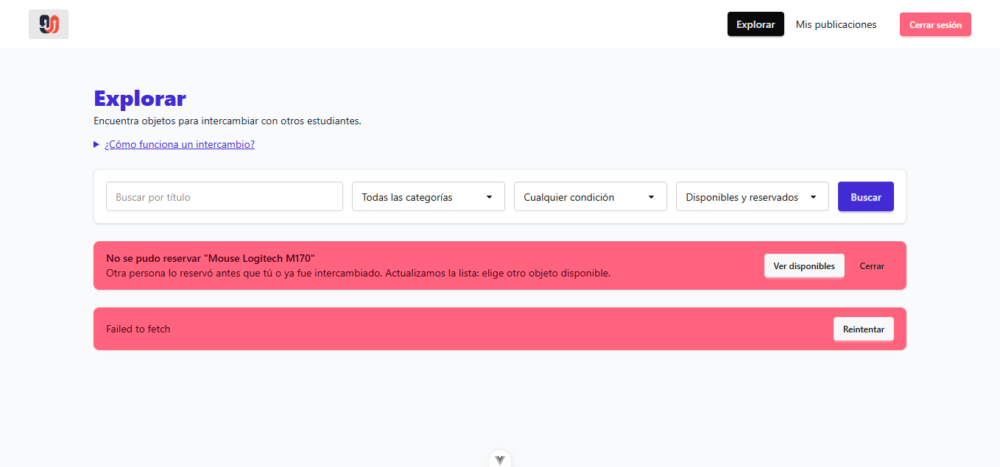
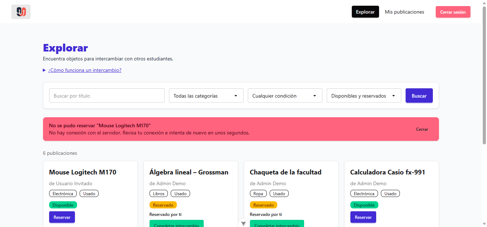

# Hallazgos de interacción: Trueque U (clase 16)

**Principios evaluados:** ley de Fitts, ley de Hick y carga cognitiva.

**Cómo se probó:** backend con `npm run seed`, sesión iniciada como **Martita Becerra** (`martita@truequeu.com`, contraseña `Password123!`), viewport de escritorio de 1358 px de ancho. Las medidas de tamaño y posición se obtuvieron con `getBoundingClientRect()` en el navegador.

**Nomenclatura de capturas** (`docs/evidencias/clase-16/`): `<principio>_<número>_<antes|despues>.png`.

---

## Hallazgo 1. Ley de Fitts: la "×" para quitar un filtro es demasiado pequeña

**Captura:**

**Justificación:**

- **Tamaño:** en Explorar, la "×" de cada chip de filtro ("Categoría: Libros ×") mide **16 × 16 px** (`DashboardView.vue:206-211`). Está por debajo del mínimo de 24 × 24 px de WCAG 2.5.8 y lejos de los 44 px recomendados para pantallas táctiles.
- **Área activa:** solo el ícono responde al clic. El chip mide 171 × 28 px, pero si se toca el texto del chip no pasa nada.
- **Distancia:** la otra forma de quitar filtros, "Limpiar filtros", está en el extremo opuesto de la fila (x = 1122 px). La "×" del primer chip está en x = 260 px, unos 860 px más a la izquierda.

**Consecuencia:** quitar un filtro exige apuntar con precisión. En móvil es fácil fallar el toque o pulsar el chip vecino.

**Corrección:**

- `DashboardView.vue`: cada chip ahora es un botón completo. Al pulsar cualquier parte del chip (texto o "×") se quita ese filtro. La "×" pasó de 16 a 20 px y el botón tiene un `aria-label` con el nombre del filtro.
- "Limpiar filtros" se movió justo al lado de los chips, en lugar del extremo opuesto de la fila.

**Comprobación:** con los filtros Categoría: Libros y Estado: Disponible, el área que responde al clic es todo el chip: **146 × 32 px** y **155 × 32 px**, por encima del mínimo de 24 × 24 px. "Limpiar filtros" quedó en x = 443 px, a 7 px del último chip (antes estaba a unos 860 px de la primera "×").

| Antes                                      | Después                                      |
| ------------------------------------------ | -------------------------------------------- |
|  |  |

**Estado:** Corregido.

---

## Hallazgo 2. Ley de Hick: todos los filtros se muestran a la vez

**Captura:**

**Justificación:**

- **Cantidad:** la barra de Explorar muestra **5 controles al mismo tiempo**: búsqueda, Categoría (5 opciones), Condición (3 opciones), Estado (4 opciones) y el botón "Buscar" (`DashboardView.vue:178-200`). En total son 12 opciones en las listas.
- **Agrupación:** los tres selects tienen el mismo tamaño y el mismo peso visual. No se distinguen los filtros que se usan casi siempre (la búsqueda por título y el estado) de los secundarios (la condición).
- **Comparar:** los selects aplican el filtro apenas cambian, pero el texto de búsqueda solo se aplica al pulsar "Buscar". La persona tiene que decidir si hace falta pulsar "Buscar" o no.

**Consecuencia:** antes de buscar un objeto, la persona revisa cinco controles y evalúa opciones que la mayoría de las veces no necesita. Eso aumenta el tiempo de decisión en el primer paso de la tarea.

**Corrección:**

- `DashboardView.vue`: la barra muestra solo los filtros que más se usan: la búsqueda por título y el Estado. Categoría y Condición quedan detrás del botón **"Más filtros"**, que muestra cuántos de esos filtros están activos y se abre solo si alguno ya está aplicado.
- Se quitó el botón "Buscar". El texto se aplica solo, 400 ms después de dejar de escribir (o al pulsar Enter), igual que los selects. Ya no hay que decidir si hace falta pulsar algo.

**Comprobación:** al entrar a Explorar se ven **3 controles** en lugar de 5, con 4 opciones en la única lista visible (antes 12 en tres listas). Al escribir "calc" en la búsqueda, sin pulsar nada, la dirección cambia a `?q=calc` y la lista muestra "1 resultado".

| Antes                                     | Después                                     |
| ----------------------------------------- | ------------------------------------------- |
|  |  |

**Estado:** Corregido.

---

## Hallazgo 3. Carga cognitiva: dos alertas contradictorias cuando el servidor no responde

**Captura:**

**Justificación:**

- **Cantidad:** al pulsar "Reservar" con el servidor caído aparecen **dos alertas rojas apiladas**, cada una con sus propios botones ("Ver disponibles", "Cerrar" y "Reintentar"). Son tres salidas posibles para un solo problema.
- **Interpretar:** la primera alerta dice "Otra persona lo reservó antes que tú o ya fue intercambiado", lo cual es falso porque nadie lo reservó. El `catch` de `DashboardView.vue:124-130` muestra ese texto ante cualquier error. La segunda alerta muestra "Failed to fetch", un texto técnico del navegador que la persona no sabe interpretar.
- **Comparar:** la persona tiene que comparar los dos mensajes, que se contradicen ("alguien lo reservó" frente a "falló la carga"), para deducir qué pasó realmente.
- **Recordar:** ninguna alerta dice qué hacer. La persona tiene que recordar o adivinar que debe esperar y volver a intentar.

**Consecuencia:** la persona cree que perdió el objeto, cuando en realidad no hay conexión. Puede abandonar la tarea o pulsar "Ver disponibles", que tampoco funciona sin servidor.

**Corrección:**

- `stores/posts.js`: todas las peticiones pasan por `request()`. Si el servidor no responde, lanza un error marcado como `network` con el mensaje **"No hay conexión con el servidor. Revisa tu conexión e intenta de nuevo en unos segundos."**, en lugar de "Failed to fetch".
- `DashboardView.vue`: ante un error de red, Reservar, Liberar reserva y Completar intercambio muestran ese mensaje y **no recargan la lista**, porque la recarga volvería a fallar y apilaría una segunda alerta. El mensaje de "otra persona lo reservó" queda solo para los rechazos reales del servidor.

**Comprobación:** con la lista cargada se detuvo el backend y se pulsó "Reservar" en "Mouse Logitech M170". Aparece **una sola alerta**, con el motivo real y una sola salida ("Cerrar"). Las tarjetas siguen visibles.

| Antes                                     | Después                                     |
| ----------------------------------------- | ------------------------------------------- |
|  |  |

**Estado:** Corregido.
